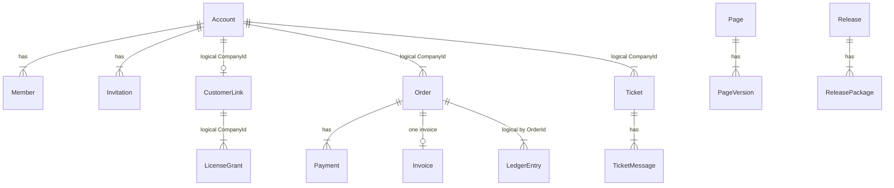

# Database

## Provider

- Production and development configuration: SQL Server via `UseSqlServer` and `ConnectionStrings:Default`.
- Image used in compose and CI: `mcr.microsoft.com/mssql/server:2022-latest`.
- EF Core SQL Server package: 10.0.13 (`Directory.Packages.props`).
- Tests: SQLite unless environment variable `TEST_SQLSERVER` is set (`.github/workflows/ci.yml` job `backend-sqlserver`). Package `Microsoft.EntityFrameworkCore.Sqlite` 10.0.12 is referenced by the test project for that path.
- One database, eight schemas. No cross-schema foreign keys. Relationships between modules are Guid values in columns.

Findings are from `OnModelCreating` in each DbContext. Migration names were listed. Designer and snapshot files were not diffed line by line. No live database was opened.

## Contexts and initializers

| DbContext | Schema | History table | Initialization key |
| --- | --- | --- | --- |
| `IdentityDb` | `identity` | `__EFMigrationsHistory` | `Identity:DatabaseInitialization` |
| `CustomersDb` | `customers` | same, per schema | `Customers:DatabaseInitialization` |
| `LicensesDb` | `licenses` | same | `Licenses:DatabaseInitialization` |
| `CommerceDb` | `commerce` | same | `Commerce:DatabaseInitialization` |
| `ReleasesDb` | `releases` | same | `Releases:DatabaseInitialization` |
| `SupportDb` | `support` | same | `Support:DatabaseInitialization` |
| `ContentDb` | `content` | same | `Content:DatabaseInitialization` |
| `AuditDb` | `audit` | same | `Audit:DatabaseInitialization` |

`appsettings.json` sets every one of these to `Migrate`. Tests pass `EnsureCreated` or `None` through the factory (not re-read in full; `ApiFactory.cs` exists for this). `None` on Identity returns before role seeding (`IdentitySeeder`).

Startup runs `MigrateAsync` inside `IHostedLifecycleService.StartingAsync`, before data-protection key reads. Confirmed comment on `IdentitySeeder`.

## Tables (current model)

### identity

ASP.NET Identity tables for `ApplicationUser` / `ApplicationRole` (Guid keys): users, roles, user-roles, claims, logins, tokens, role-claims. Extra columns on users: `FullName` max 100 (same limit as `RegisterValidator`), `CreatedAt`. Email max 256, unique email required.

`SecurityEvents`: Id, UserId nullable, Type string, OccurredAt, IpAddress max 45. Indexes `(UserId, OccurredAt)`, `OccurredAt`.

`DataProtectionKeys`: EF data-protection key ring (cookie and token signing keys).

### customers

`Accounts`: Id, Name 150, CreatedAt.  
`Members`: Id, AccountId FK cascade, UserId **unique**, Role string, JoinedAt.  
`Invitations`: Id, AccountId FK cascade, Email 256, Role, Status, TokenHash 64 **unique**, InvitedBy, CreatedAt, ExpiresAt.

### licenses

`CustomerLinks`: CompanyId PK, PlatformCustomerId **unique**, LinkedAt.  
`Grants`: Id, CompanyId, PlanId, OrderReference 100 **unique**, Status, CreatedAt, PlatformSubscriptionId, PlatformLicenseId, LicenseNumber 64, ExpiresAt, ProtectedProductKey 2000, IssuedAt, ExpiryReminderDays. Index `(CompanyId, PlatformLicenseId)`.

### commerce

`Orders`: Id, Number 20 **unique**, CompanyId, PlacedBy, PlanId, ProductName, PlanName, Total decimal(18,2), Currency 3, Status, PlacedAt, PaidAt, PaidVia, LicenseNumber. Indexes `(CompanyId, PlacedAt)`, `Status`.  
`Payments`: Id, OrderId FK cascade, Provider, ProviderReference, Amount, Currency, Status, CreatedAt, CompletedAt, FailureReason 200. Unique filtered index `(Provider, ProviderReference)` where reference is not null.  
`ProcessedNotifications`: PK `(Provider, EventId)`.  
`Invoices`: Id, Number **unique**, OrderId **unique**, CompanyId index, CompanyName, Description, Amount, Currency, IssuedAt.  
`InvoiceCounters`: Year PK, Last concurrency token.  
`Ledger`: Id, OrderId index, Kind, Amount, Currency, Provider, Reference, At index.

### releases

`Releases`: Id, Channel, Major, Minor, Patch, Notes 4000, Manifest, Signature 512, Status, CreatedAt, PublishedAt. Unique `(Channel, Major, Minor, Patch)`.  
`ReleasePackages`: owned collection, Platform, Url 500, Sha256 64, Size.

### support

`Tickets`: Id, Number **unique**, CompanyId, OpenedBy, Subject, Category, Status, OpenedAt, LastActivityAt. Indexes `(CompanyId, Status)`, `(Status, LastActivityAt)`.  
`TicketMessages`: owned, AuthorUserId, FromStaff, Body, PostedAt.  
`Suggestions`: CompanyId index, UserId, Title, Body, Status, StaffNote, CreatedAt, AnsweredAt. Index `(Status, CreatedAt)`.  
`DemoRequests`: Name, Company, Email, Phone, Sites, Message, Language, Status, StaffNote, CreatedAt, HandledAt. Indexes `(Status, CreatedAt)`, `(Email, CreatedAt)`.

### content

`Pages`: Id, Slug **unique**, CreatedAt, UpdatedAt concurrency token, PublishedVersion.  
`PageVersions`: owned, unique `(PageId, Number)`, bilingual title/description/body, EditedBy, EditedAt, ReviewedBy, ReviewedAt, ReviewNote, PublishedAt, Status.

### audit

`Entries`: Id, At, ActorUserId, Action 60, Target 100, Detail 500, IpAddress 45. Indexes on At, `(Action, At)`, `(ActorUserId, At)`, `(Target, At)`.

## Relationship summary

Cascade delete is configured for Members, Invitations, and Payments when the parent row is deleted. No application path deletes an Account or an Order. Ticket messages, page versions, and release packages are owned collections (EF cascade on parent delete). There is no global soft-delete flag. Account deletion anonymizes the user and removes membership; invoices and orders stay.

## Concurrency

- `InvoiceCounter.Last` and `Page.UpdatedAt` are EF concurrency tokens.
- Payment provider reference and processed notification keys are unique indexes. Conflicts become `SaveConflictException` in the commerce store (implementation in `CommerceDb.cs` after the mapping; behavior confirmed by `HandlePaymentNotificationHandler`).
- Orders have no row version. Two manual payments racing rely on status checks in memory and the last save winning unless a unique constraint fires. **Inferred:** two concurrent manual payments could both pass `PendingPayment` before either saves. Confidence medium; not executed.

## Multi-tenancy

No tenant column interceptor and no global query filter. Isolation is "load by the caller's membership" in customer handlers, and explicit `companyId` only on staff endpoints.

## Transactions

`SaveChangesAsync` is the transaction boundary. Audit writes are a second transaction and may fail independently. License grant saves are a third database context from the commerce save. There is no `TransactionScope` across contexts in the files that were read.

## Not present

No SQL views, no stored procedures, no seed SQL scripts in the repository. Seed data is the Identity role rows and the optional bootstrap admin, created in code.

## Integrity risks

- Cross-schema ids can dangle (company deleted is not possible today; user anonymized leaves `PlacedBy` pointing at a locked user id, which is intended).
- `ProtectedProductKey` is ciphertext. Losing the data-protection certificate makes keys unreadable (`docs/operations/deploy.md` describes the certificate; not re-validated against a running system).
- Catalog and license bodies are not stored locally except the grant row. Platform downtime loses live device lists; grants and keys remain.
